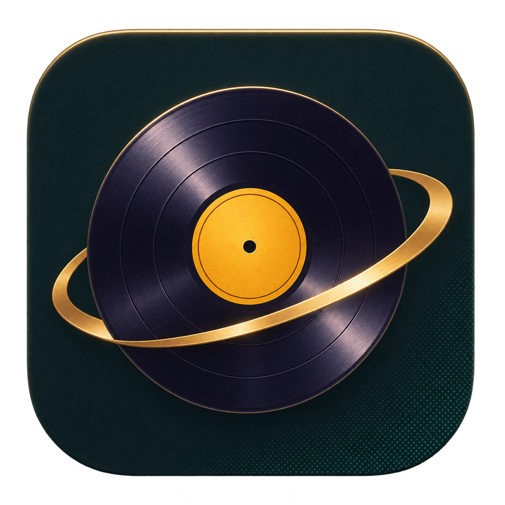

# MOSIC 音乐宇宙

如果有人也把你喜欢的那首歌放上了自己的唱片架，你想听听旁边还摆着什么吗？在 MOSIC，每个人都有一颗由选曲塑造的像素星球。驾驶飞船，顺着一首共同喜欢的歌，就能去拜访另一位听众。

[进入网页版](https://moodverse-care.pages.dev/) · [下载 Mac 应用](https://moodverse-care.pages.dev/desktop/) · [GitHub 最新发行版](https://github.com/luke711-xyy/moodverse-care/releases/latest) · [音乐版源码](https://github.com/luke711-xyy/moodverse-care/tree/codex/mosic-copilot)

## 第一次登舰

1. **点亮自己的星球。** 第一次登舰时选三首不同的歌，预览星球随选曲变化的样子。给星球取个名字，选择公开或私密。之后还可以调整唱片架上的歌，最多保留五首。
2. **顺着一首歌去串门。** 在自己的星球上选一首歌，点击「撞歌」。找到也选过这首歌的公开星球后，可以前往听对方的歌、翻看对方的 Moment，再从另一首歌继续漫游。
3. **让副驾帮你点歌。** 副驾初次打开显示「未配置」。在「设置与记忆」接好自己的模型后，输入「想听一首适合夜航的慢歌」，从推荐中挑一首播放。也可以按住说话，看转写逐步填入输入框，松手校对后点「发送」。

副驾可以缩在星图旁，一边航行一边聊天。「通讯」显示设备当地当天的对话，「历史」支持按日、周、月、年翻阅。在「设置与记忆」中可以清空当前来源的聊天记录。

## Mac 客户端

在 GitHub Release 的 **Assets** 中下载 `mosic-macos-arm64.zip`，解压后将 **MOSIC.app** 移入「应用程序」。同一发行版提供桌面端源码包 `mosic-source.zip`。当前安装包适用于 Apple Silicon Mac，采用本地签名，尚未通过 Apple 公证。[v0.1.5 发行版](https://github.com/luke711-xyy/moodverse-care/releases/tag/v0.1.5) · [首次打开说明](https://moodverse-care.pages.dev/desktop/)

网页和 Mac 应用都提供本机模型配置提示词。复制给自己电脑上的 Agent，它会检查 Ollama、LM Studio 等运行时，列出已安装的模型，请你确认想用哪一个。如果需要下载，可以先用 llmfit 按内存、显存和磁盘空间挑选合适的模型。确认后，浏览器或 Mac 通过本机回环地址连接该模型。

也可以选择「自定义 API」，填服务商的 HTTPS 接口、API Key 和模型。支持 OpenAI Chat Completions、OpenAI Responses、Anthropic Messages 和自定义 JSON。在 Mac 应用按 **⌘,** 打开本机连接设置，还可以选择「Codex CLI · ChatGPT 订阅」或「GitHub Copilot CLI · Copilot 订阅」，通过这台 Mac 上已登录的官方 CLI 使用自己的套餐额度。离线电台也可以浏览本机已存的曲目和聊天记录。[桌面端安装与连接说明](https://github.com/luke711-xyy/moodverse-care/blob/v0.1.5/desktop/README.md)

## 本地开发

音乐版在 `codex/mosic-copilot` 分支开发。准备好 Node.js 24 和 npm 后，克隆音乐分支并启动 Vite 前端开发服务器。

```sh
git clone --branch codex/mosic-copilot https://github.com/luke711-xyy/moodverse-care.git
cd moodverse-care
npm ci
npm run dev
```

`npm run build` 会执行 TypeScript 检查并生成网页到 `dist/`。曲库、星球和聊天接口由 Cloudflare Pages Functions 提供，持久化数据使用 D1。需要体验完整联网流程时，可以直接打开[正式驾驶舱](https://moodverse-care.pages.dev/)。

桌面端使用 Electron。在 macOS 上安装好 Xcode 命令行工具后，可从源码启动。

```sh
cd desktop
npm ci
sh speech/build.sh
npm start
```

桌面客户端源码采用 MIT 许可证，第三方运行时和字体沿用各自的许可证。[桌面端许可证](https://github.com/luke711-xyy/moodverse-care/blob/v0.1.5/desktop/LICENSE) · [字体说明](https://github.com/luke711-xyy/moodverse-care/blob/v0.1.5/public/fonts/README.md)
